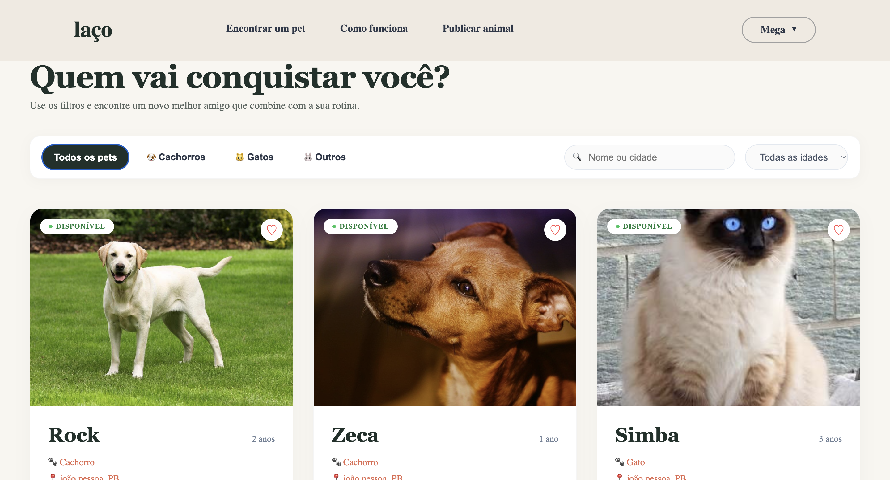
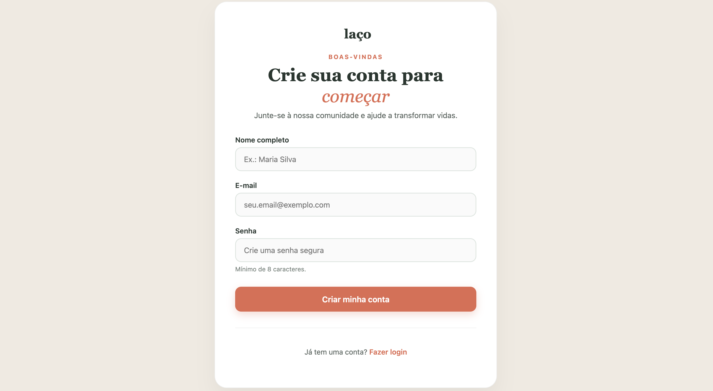
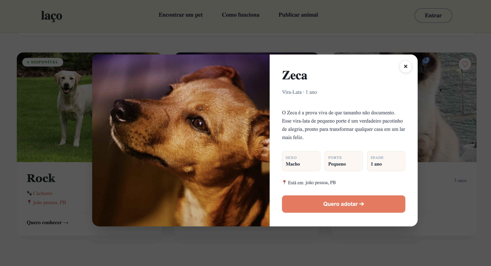
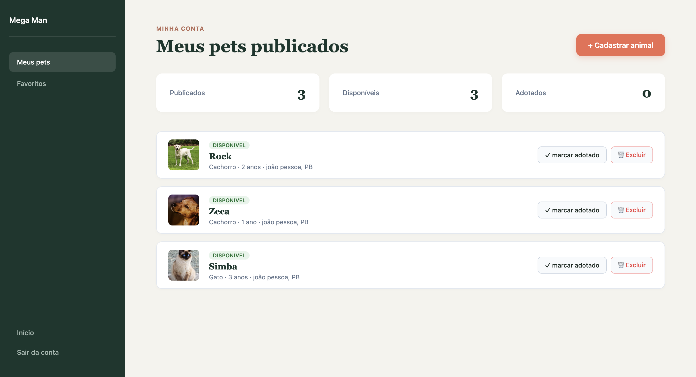
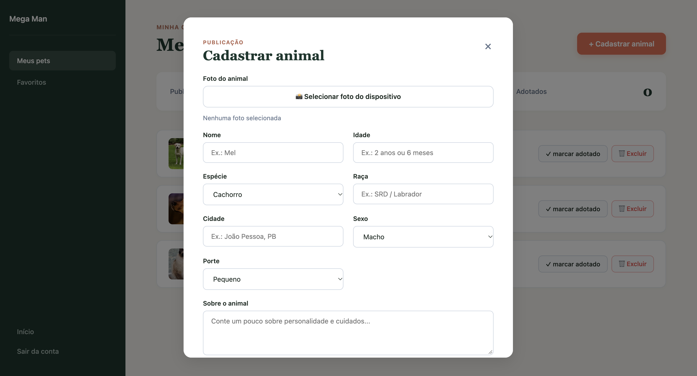
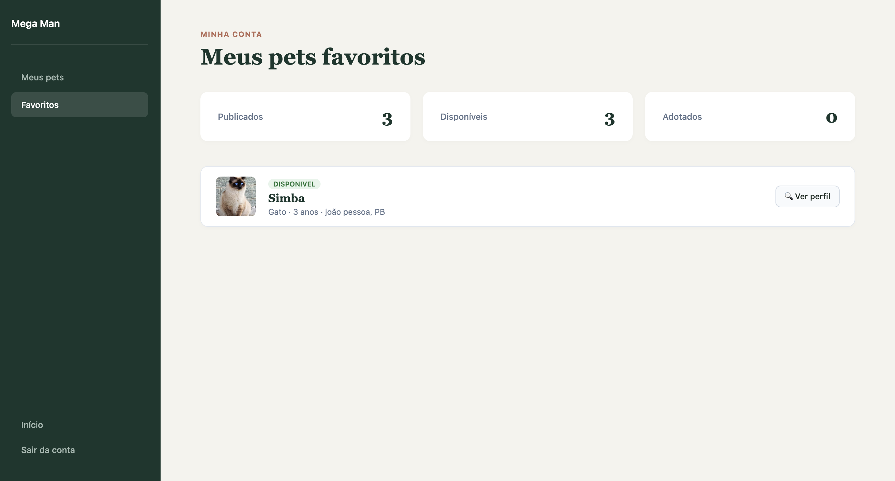

# 🐾 Laço — Plataforma de Adoção de Animais

> "Uma ponte digital entre o carinho de quem resgata e o desejo de quem quer adotar."

O **Laço** é uma aplicação web desenvolvida para facilitar o processo de adoção responsável de animais de estimação. A plataforma centraliza anúncios de pets, permitindo que potenciais adotantes filtrem, visualizem detalhes completos e entrem em contacto direto através do WhatsApp, além de oferecer uma área dedicada para utilizadores gerirem e publicarem os seus próprios animais.

---

## Descrição das funcionalidades do projeto

### Telas do sistema

#### Página Inicial / Filtros

#### Painel de cadastro

#### Painel de login

#### Modal de Detalhes do Animal

#### Painel de perfil / pets cadastrados

#### Modal de cadastro de pets

#### Painel de favoritos

---

### Funcionalidades disponíveis

| Funcionalidade | Descrição |
| :--- | :--- |
| **Página inicial com filtros** | Exploração dinâmica de pets disponíveis com opções de busca e filtragem por **espécie**, **nome ou cidade** e **faixa etária**. |
| **Modal de detalhes dinâmico** | Exibição de informações completas do animal selecionado (história, características e fotos). |
| **Integração com o WhatsApp** | Botão direto no modal para iniciar conversa instantânea sobre a adoção. |
| **Sistema de favoritos** | Possibilidade de guardar os pets preferidos para consulta posterior no painel de perfil. |
| **Controlo de acesso** | Com autenticação simulada. |
| **Painel de perfil** | Área restrita do utilizador para gerir favoritos, ver dados e navegar facilmente de volta ao início. |

---

## Instruções de instalação

### Pré-requisitos

- **Git** instalado na tua máquina.
- **Node.js** e **npm** instalados.
- Navegador web atualizado (Chrome, Edge, Firefox, Safari).

### Executar localmente

1. Clone o repositório rodando `git clone https://github.com/teu-utilizador/projeto-laco.git` no terminal.
2. Acesse a pasta do projeto com o comando `cd projeto-laco`.
3. Instale as dependências executando `npm install`.
4. Inicie o servidor de desenvolvimento com o comando `npm run dev`.
5. Abra o navegador no endereço indicado pelo Vite (normalmente `http://localhost:5173/`).

---
